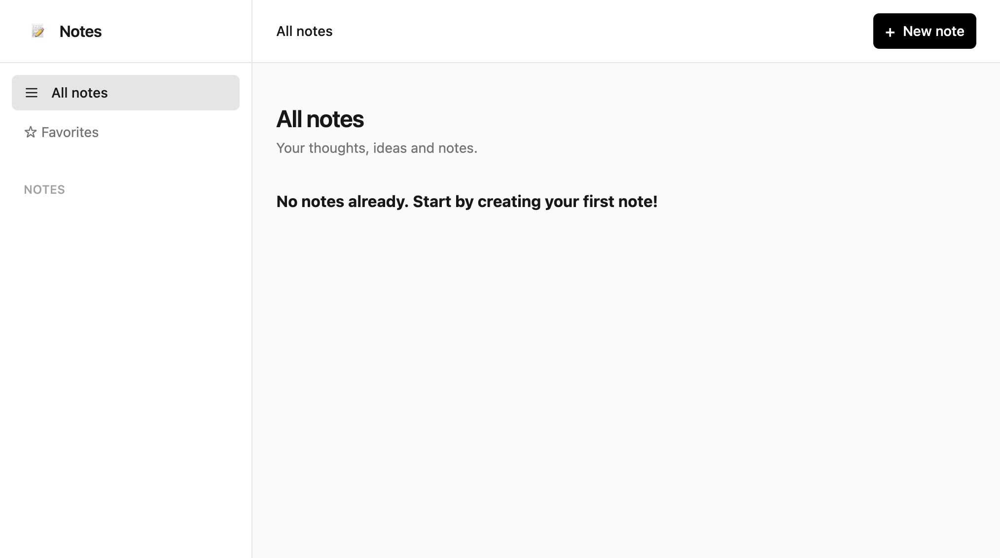
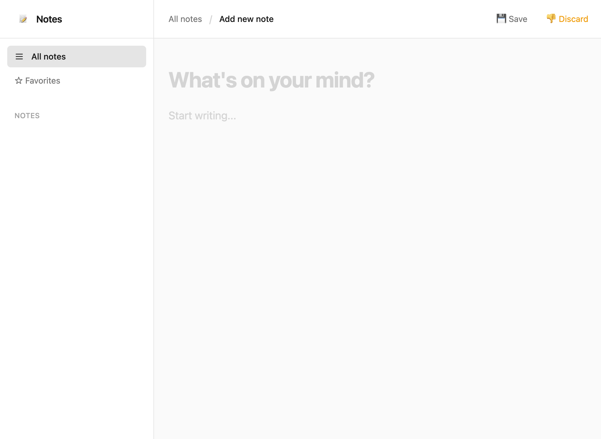
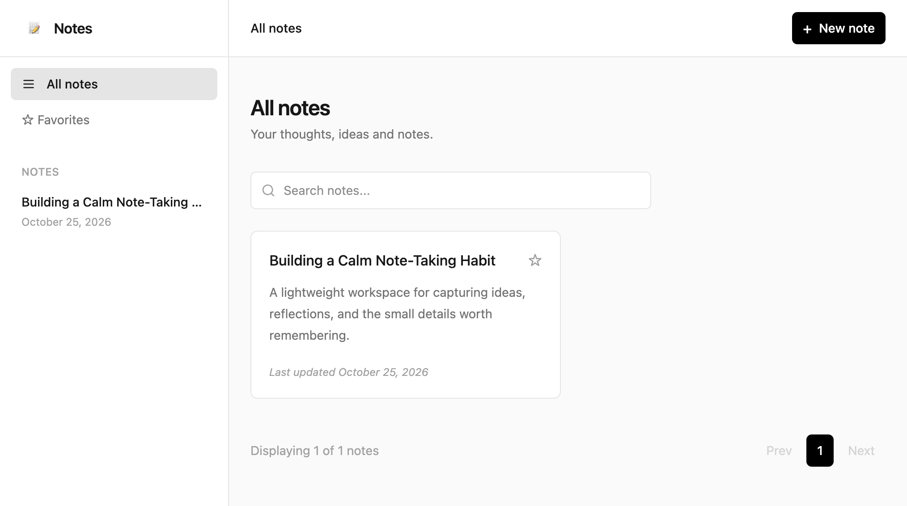
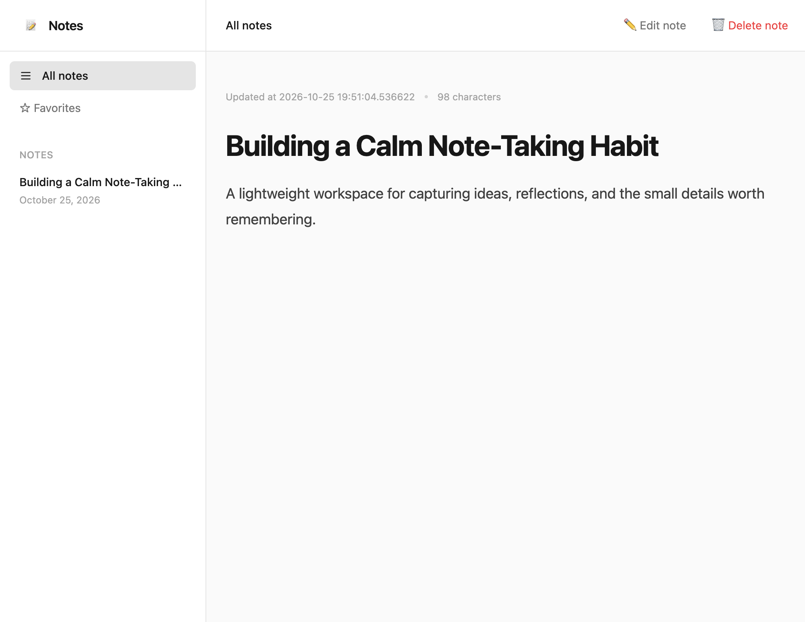
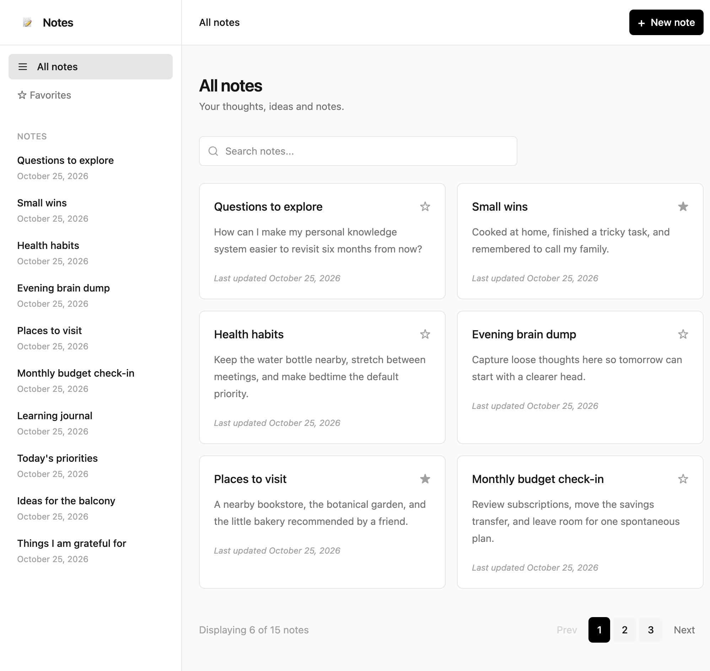
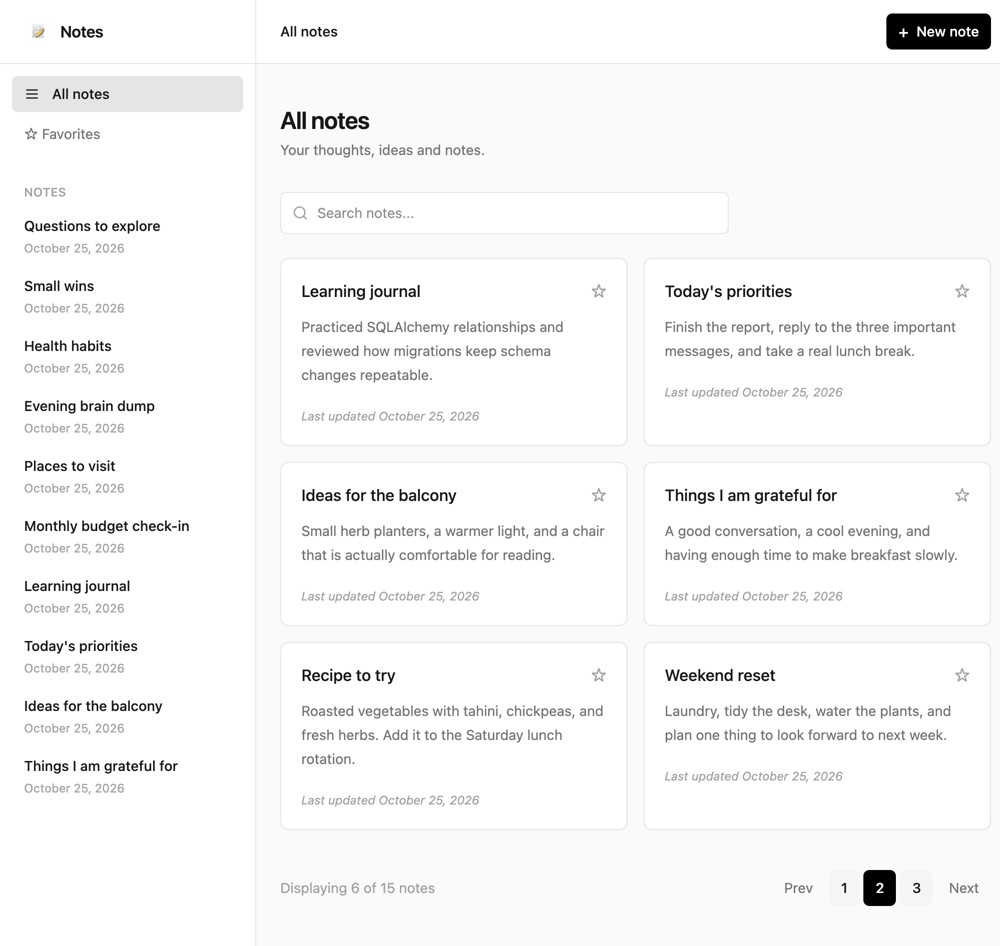
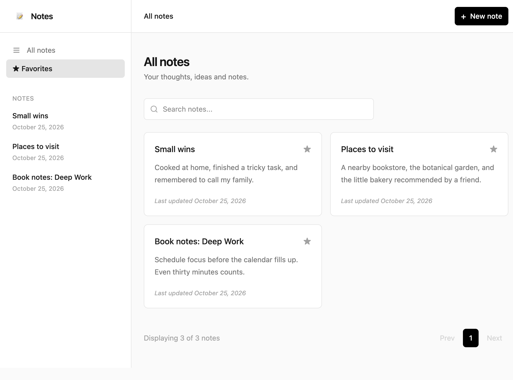
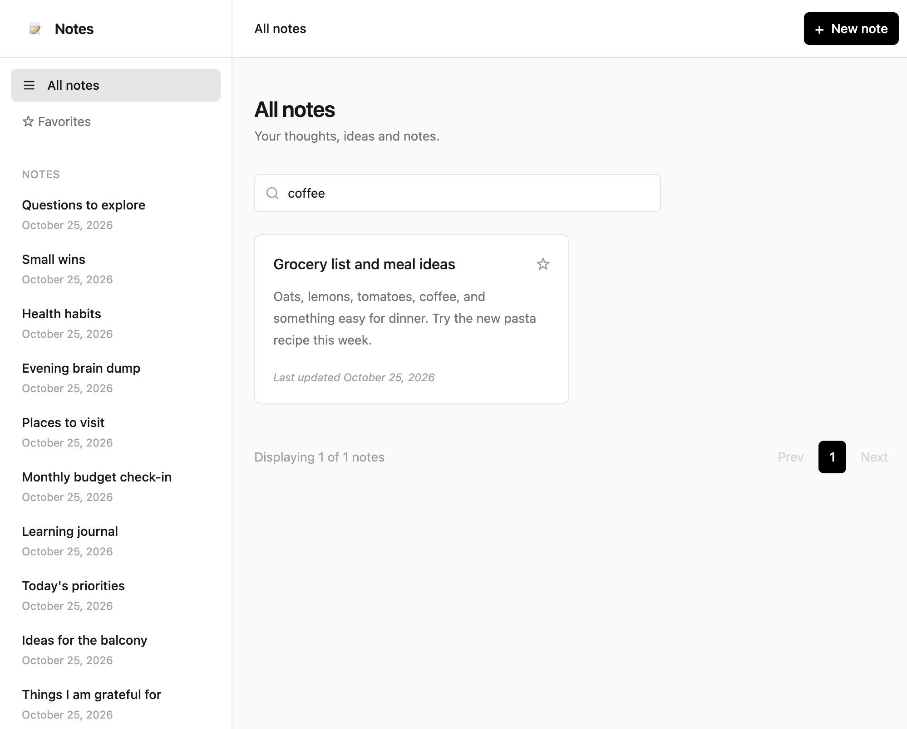

# Flask Notes

> A focused, calm workspace for capturing ideas, reflections, and everyday notes.

Flask Notes is a  CRUD notes application built with Flask with a clean responsive interface. Create a note, find it quickly, favorite what matters, and keep a lightweight archive of your thinking.

## Product walkthrough

### Start with an empty workspace



### Create, browse, and read notes







### Scale to a larger collection





### Mark favorites and search your notes



Click the star on any note to mark it as a favorite. The Favorites view narrows the main list to only those notes, while search also scans note content—not only titles.



## Key features

- Create, view, edit, and delete notes.
- Automatic readable and unique URL slugs.
- Search across note titles and content.
- Favorite and filter important notes.
- Paginated note browsing.
- Responsive layout with a persistent navigation sidebar.
- SQLite persistence with Alembic migrations.
- Server-side title validation and safe mutation rollbacks.

## Technology stack

- **Backend:** Python 3.13+, Flask 3.1
- **Data layer:** Flask-SQLAlchemy, SQLAlchemy 2.x, SQLite
- **Migrations:** Flask-Alembic / Alembic
- **Templating:** Jinja2
- **Styling:** Tailwind CSS browser build
- **Utilities:** python-slugify, python-dotenv
- **QA:** Flask test client, Playwright walkthroughs, Pylance diagnostics

## Designed to grow

The app uses a simple layered architecture so the interface can remain lightweight while the data layer evolves:

- **Repository layer:** database queries for pagination, search, favorites, and slug lookup are kept separate from HTTP handlers.
- **Service layer:** note creation, editing, slug generation, commits, and rollback behavior are centralized in `NoteService`.
- **Alembic migrations:** schema changes are versioned and repeatable, making it safer to move from the local SQLite database to another deployment environment.
- **Pagination:** list queries return bounded pages instead of rendering the entire collection at once, keeping the UI usable as the number of notes increases.
- **SQLite today, extensible tomorrow:** the SQLAlchemy model and repository boundaries make a future PostgreSQL deployment straightforward.

## Getting started

This project uses [uv](https://docs.astral.sh/uv/) for fast, reproducible Python environment and dependency management.

### Install uv

```bash
curl -LsSf https://astral.sh/uv/install.sh | sh
```

See the [official uv installation guide](https://docs.astral.sh/uv/getting-started/installation/) for Windows and alternative installation methods.

### Install dependencies

```bash
uv sync
```

### Configure environment

```bash
cp .env.example .env
```

Set a strong `SECRET_KEY` in `.env` before deploying the application.

### Run the application

```bash
uv run flask --app app run --debug
```

Then open [http://127.0.0.1:5000](http://127.0.0.1:5000).

## Project structure

```text
app/
├── models/       SQLAlchemy models and database setup
├── notes/        Routes, service layer, repository, and slug generation
├── templates/    Jinja views for list, detail, add, and edit flows
├── migrations/   Alembic database migrations
└── config.py     Environment-backed application configuration
```


## License

This project is released under the [MIT License](LICENSE).
